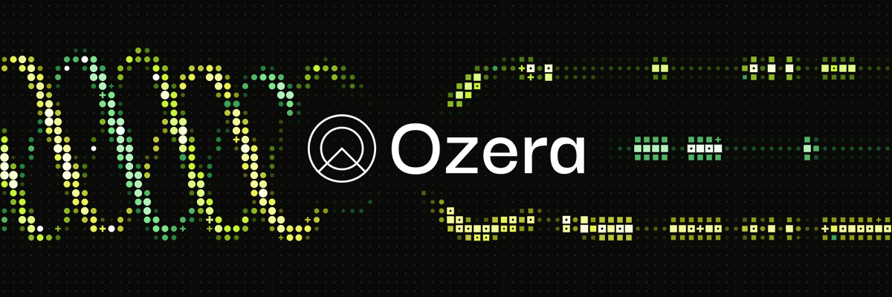

A workbench for interpretability research on language models

**Live at [ozera.app](https://ozera.app)**

## Overview

Ozera lets you run interpretability experiments on a language model from the browser, with no code to write. You can inspect activations and attention layer by layer, patch and ablate them, read sparse autoencoder (SAE) features, train linear probes, and map the shape a concept takes inside the model. It works on Ozera's own from-scratch models, on popular open-source models, and on models you train or upload. Runs go to serverless GPUs and are paid for with prepaid credits.

## Features

### Instruments

- **Generate:** Stream a completion with temperature, top-k and top-p controls, then open any layer of it: the top predictions at each position, attention heatmaps, layer activations, and how the embeddings change through the network. A saved probe can score each token as it is generated.
- **Activation Patching:** Copy activations from one prompt into another at any layer, head or position, or ablate them (zero, mean, noise), and compare what the model generates with and without the intervention.
- **Attention Analysis:** Classify every attention head (induction, previous-token, positional, copying and more), compare attention across two prompts, and mine patterns across layers.
- **SAE Analysis:** See which features fire on each token of a text, browse an SAE's features with corpus statistics and top contexts, check reconstruction quality, and compare two SAEs or layers. Load SAEs from HuggingFace or Gemma Scope, or upload your own.
- **Probe Lab:** Fit linear probes at every layer of the residual stream, with shuffled-label controls. Then score text token by token, test generalization across datasets and between base and instruct models, steer with the probe's direction, ablate it, or compare it with SAE features.
- **Geometry Lab:** Find the shape a concept (days, months, numbers, or your own) takes in the residual stream, test it against circle, line and cluster hypotheses, steer the model along it, and see how an SAE breaks it up. The atlas reads a corpus through an SAE and groups its features into communities.
- **Custom Models:** Train the Ozera architecture on your own text with the cost estimated up front, or upload model weights. Custom models work in every instrument.

### Around them

- **Assistant:** A side panel on every page, powered by Claude. Ask in plain language and it sets up and runs experiments for you, then explains the results. It asks for approval before each step by default, and a chat can have a spending limit.
- **Autointerp:** Claude writes an explanation for an SAE feature from its activating contexts, and a second model scores that explanation on held-out contexts against baselines. Run it on one feature or a whole SAE, or test your own hypotheses.
- **Figure export:** Publication-ready figures (PNG, PDF, SVG) with presets for NeurIPS, ICLR, ICML and Nature, one at a time or as a batch ZIP.
- **Credits:** Stripe-powered prepaid credits. You pay only for what you run, and longer jobs show an estimate first.

## Models

### Ozera Models (built from scratch, trained on OpenWebText)

| Model | Parameters | Layers | Heads | Hidden Dim |
|-------|-----------|--------|-------|------------|
| Ozera-Nano | 12.4M | 6 | 6 | 192 |
| Ozera-Mini | 51.2M | 8 | 8 | 512 |

Both come with SAEs trained on the residual stream and MLP output of every layer.

### Open-Source Models

| Model | Parameters | Family |
|-------|-----------|--------|
| SmolLM2 135M | 135M | SmolLM |
| SmolLM2 360M | 360M | SmolLM |
| SmolLM3 3B | 3B | SmolLM |
| Gemma 3 270M | 270M | Gemma |
| Gemma 3 1B | 1B | Gemma |
| Qwen3 0.6B | 600M | Qwen |
| Qwen3 1.7B | 1.7B | Qwen |
| Qwen3 4B | 4B | Qwen |

Each open-source model is also available as an instruction-tuned variant; prompts to those are wrapped in the model's chat template.

Users can also upload their own model weights, or train Ozera models on their own data.

## Project Structure

```
ozera/
├── backend/
│   ├── api/              # FastAPI routes, one file per feature
│   ├── core/             # Model and analysis code (also runs on the GPU workers)
│   │   ├── transformer/  # Ozera model architecture (NumPy reference + PyTorch)
│   │   ├── math_primitives/  # Pure math implementations of attention, activations, positional encoding
│   │   ├── training/     # Training loop, optimizer, data pipeline
│   │   ├── tokenizer/    # BPE tokenizer
│   │   ├── open_source/  # SmolLM, Gemma, Qwen loaders with activation hooks
│   │   ├── patching/     # Activation patching engine
│   │   ├── analysis/     # Head classification, pattern mining
│   │   ├── sae/          # Sparse autoencoders: training, analysis, external loaders
│   │   ├── probes/       # Linear probes: sweeps, steering, ablation, transfer
│   │   ├── geometry/     # Concept shapes, manifold steering, feature atlas
│   │   ├── autointerp/   # Feature explanations and scoring with Claude
│   │   ├── assistant/    # Assistant tools, prompt, and turn loop
│   │   └── export/       # Figure generation
│   ├── inference/        # Model loading, activation store, text generation
│   ├── services/         # Modal workers, Stripe, Supabase, credit system, job orchestration
│   ├── middleware/       # Supabase auth, rate limiting
│   ├── models/           # SQLAlchemy ORM models (DB schema)
│   ├── alembic/          # Database migrations
│   ├── scripts/          # Training, data upload, and calibration scripts
│   └── tests/
├── frontend/
    └── src/
        ├── pages/        # Home, Generate, Custom Models, Patching, Analysis, SAE, Probe Lab, Geometry Lab, Settings, Auth
        ├── components/   # Per feature: visualization, patching, analysis, sae, autointerp, probes, geometry, assistant, training, payments
        ├── hooks/        # Data and state hooks per feature
        ├── stores/       # Auth, settings, and assistant state (Zustand)
        └── api/          # API client
```

## Deployment

- **Frontend**: Vercel
- **Backend**: Railway (Dockerized FastAPI)
- **Database**: Supabase (PostgreSQL + auth)
- **GPU Compute**: Modal (serverless L4 and A10G workers for inference; T4, A10G or A100 for training)
- **Storage**: Modal Volumes (model weights, SAEs, feature atlases, datasets)
- **LLM**: Anthropic API (the assistant and autointerp)
- **Payments**: Stripe
